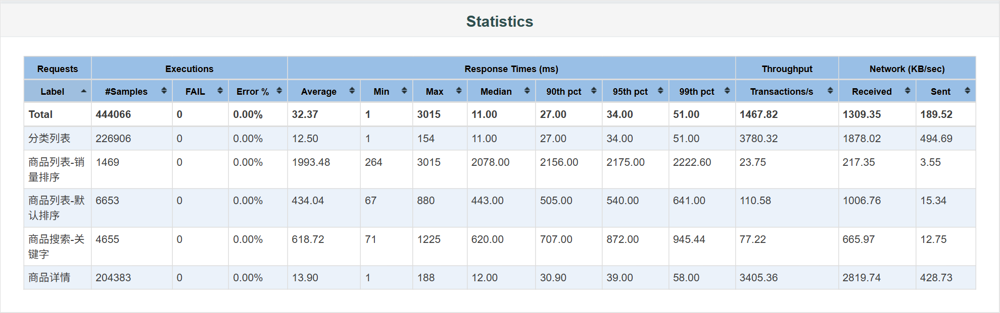
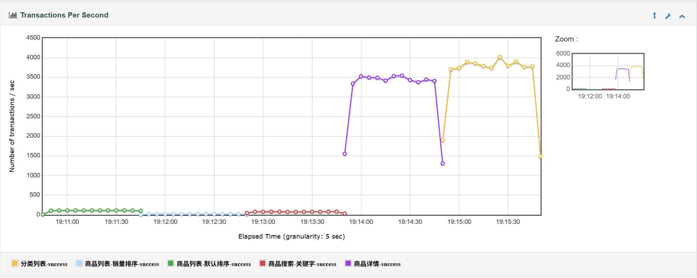
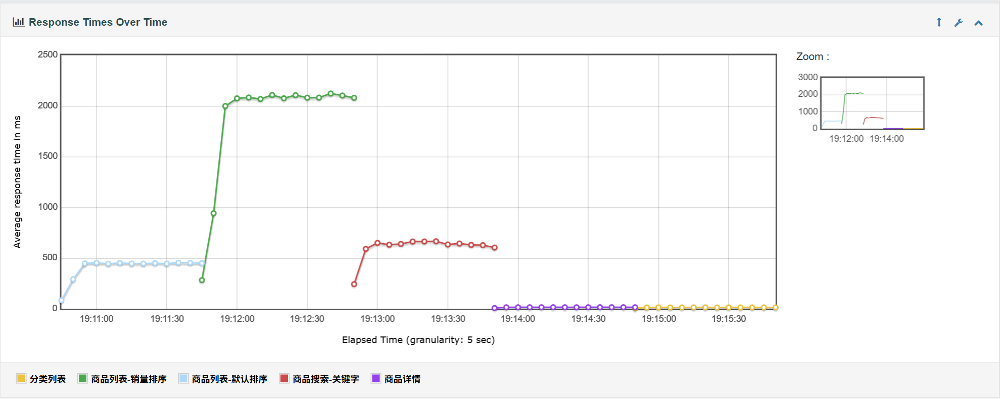
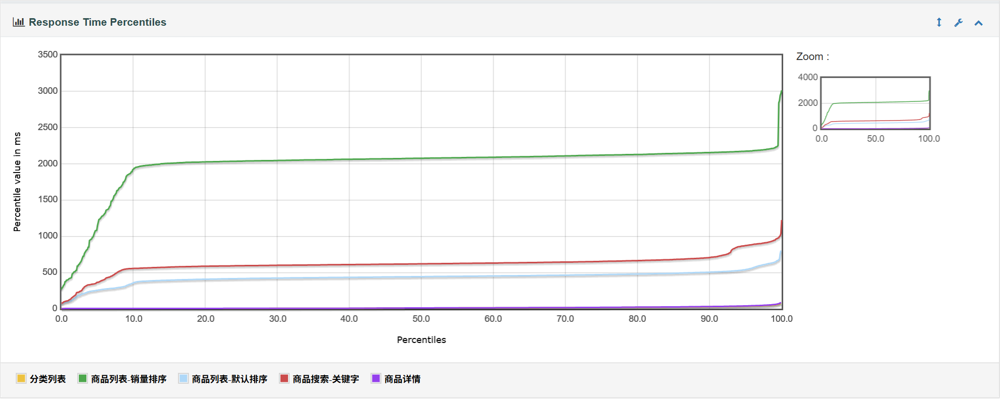
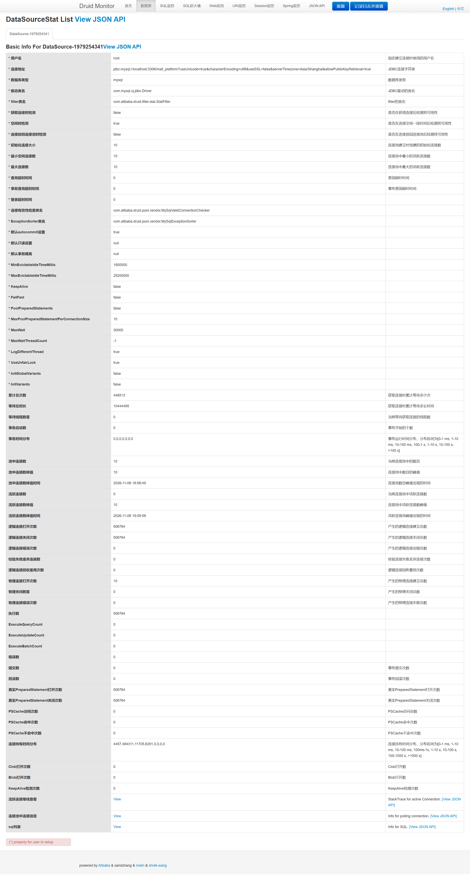
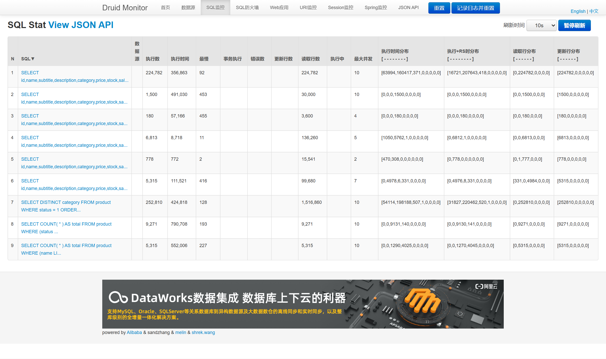

# Mall Platform（电商平台）

个人全栈项目：**Java 后端 + Vue 3 前端**的电商平台，并接入 Python 智能体服务（电商智能客服、电商问数 Text2SQL），为其提供业务数据与工具接口。

## 项目结构

| 目录 | 说明 | 状态 |
|---|---|---|
| [`api/`](api/) | Java 后端：平台业务 API、面向 AI 智能体的工具接口 | 骨架已就绪 |
| [`web/`](web/) | Vue 3 前端：商城前台 + 管理端 | 骨架已就绪 |
| `agent/` | Python 智能体服务：智能客服 / 问数） | 规划中 |

## 技术栈

- **后端**：Java 21 · Spring Boot 4.1 · Maven（已引入 Web MVC / Validation 起步依赖）
- **前端**：Vue 3 · TypeScript · Vite · Pinia · Vue Router
- **数据与基础设施**：MyBatis-Plus · MySQL · Druid（连接池）· Redis（商品缓存）· RocketMQ（消息队列）· RustFS（S3 兼容对象存储，规划中）
- **智能体（规划中）**：Python · FastAPI · LangGraph · Milvus

## 快速开始

### 环境要求

- JDK 21+
- Node.js ≥ 22.18
- Maven 3.9+
- MySQL 8（本机安装）
- Docker Desktop（运行 Redis、RocketMQ、RustFS）

### 本地依赖（Redis + RocketMQ + RustFS）

```bash
docker compose up -d     # 仓库根目录执行：Redis 8.10 + RocketMQ 5.5 + RustFS 1.0
docker compose stop      # 停止
```

端口：Redis **6379**、RocketMQ NameServer **9876** / Broker **10911** / Proxy gRPC **8081**、RustFS S3 API **9000** / 控制台 **9001**（`/rustfs/console/`），均只绑定 127.0.0.1。更多命令见 [`docker-compose.yml`](docker-compose.yml) 顶部注释。

### 后端（api/）

后端依赖 RocketMQ，启动前先执行 `docker compose up -d`；首次使用还要建一次 Topic 和消费组（命令见 [`docker-compose.yml`](docker-compose.yml) 顶部注释）。

```bash
cd api
./mvnw spring-boot:run        # Windows 下使用 mvnw.cmd spring-boot:run
```

下单后 15 分钟未支付的订单会自动取消并回补库存（RocketMQ 延时消息 + 定时扫描兜底），时长可用 `ORDER_PAY_TIMEOUT` 调整。

前台商品列表、详情、分类缓存在 Redis（`127.0.0.1:6379`，可用 `REDIS_HOST` / `REDIS_PORT` 修改）；Redis 没启动时后端照常运行，只是每次都查库。

服务默认端口 **8080**。
数据库连接池监控（Druid）：<http://127.0.0.1:8080/druid/>，只允许本机访问，默认账号 druid / druid123（可在 `api/.env` 里改）。
打包命令：`./mvnw clean package`。

### 前端（web/）

```bash
cd web
npm install
npm run dev        # 开发服务器，默认端口 5173
```

打包命令：`npm run build`（类型检查 + 生产构建）

## 性能压测

商品接口用 JMeter 压测，脚本和一键运行脚本在 [`api/bench/`](api/bench/)（`run.cmd <结果名> [并发数] [秒数]`，先 10 并发预热 10 秒再正式压测）。

- 数据量：商品表 **10 万条**（`api/src/main/resources/db/bench-product.sql` 生成）
- 压测方式：5 个场景**依次**执行（线程组串行），每个场景 **50 并发、持续 60 秒**，ramp-up 5 秒
- 环境：本机单机（后端、MySQL、Redis、JMeter 同一台 Windows 笔记本，插电），结果仅作优化前后对比参考
- 三轮在同一天夜里依次跑完，后端都用 `java -jar` 启动打包好的 jar（`spring-boot:run` 会带上 devtools 和 `-XX:TieredStopAtLevel=1`，JIT 只做初级编译，压测数据偏低）

### 优化前后对比

| 场景 | 接口 | 基线 | 加销量索引 | 加 Redis 缓存 |
|---|---|---:|---:|---:|
| 分类列表 | `GET /product/categories` | 3502 req/s · 13.5 ms | 4107 req/s · 11.5 ms | **6567 req/s · 7.2 ms** |
| 商品详情 | `GET /product/{id}`（随机 id） | 3822 req/s · 12.4 ms | 3718 req/s · 12.7 ms | **3930 req/s · 12.0 ms** |
| 商品列表-默认排序 | `GET /product?page=1~10&pageSize=20` | 98 req/s · 488 ms | 97 req/s · 494 ms | **1529 req/s · 31 ms** |
| 商品搜索-关键字 | `GET /product?keyword=...` | 63 req/s · 754 ms | 69 req/s · 691 ms | **2000 req/s · 23 ms** |
| 商品列表-销量排序 | `GET /product?sort=sales` | 20 req/s · 2394 ms | 85 req/s · 563 ms | **1462 req/s · 33 ms** |

每格为「吞吐量 · 平均响应时间」，三轮错误率均为 0%。P99：销量排序 3860 → 1631 → 62 ms，关键字搜索 1288 → 1191 → 67 ms，商品详情 53 → 57 → 27 ms。

**加销量索引** `idx_sales (sales)`：销量排序原来全表扫描 + filesort，加索引后倒序读索引、读够一页就停，单条 SQL 从约 270 ms 降到 20 ms，接口吞吐量 ×4.3。剩下的时间花在每次请求都要做的 `COUNT(*)`（统计在售总数，约 50~100 ms）上，和默认排序持平；其余接口不受影响。

- 没用 `(status, sales)`：先试过这个组合索引，销量排序一样快，但 `status` 只有 0/1 且九成是 1，优化器会拿它走 ref——关键字搜索的 COUNT 先读 9 万条索引项再逐条回表，接口吞吐量从 77 掉到 13 req/s；按价格 / 最新排序也慢了一倍多（单条 SQL 实测）。

**加 Redis 缓存**（Spring Cache + Redis，Cache Aside，配置见 `CacheConfiguration`）：前台列表、计数、详情、分类都先查 Redis。列表类接口吞吐量提高 15~30 倍，响应时间从数百毫秒降到 30 ms 左右。

- 详情接口吞吐量基本没变：按主键查一行本来就不到 2 ms，瓶颈在 HTTP 和 JSON 序列化；而且压测在 10 万个 ID 里随机取，平均每个 ID 只被访问两三次，首次访问都要查库（未命中约四成）。缓存主要压低了长尾（P99 减半）、减轻了数据库压力
- 这是缓存的最佳情况：压测只读，列表只有 10 页、搜索词只有 16 个，几乎全部命中；真实流量里搜索词分散、还有写操作，提升幅度会小一些
- 一致性：后台改商品后立即删详情、清空列表缓存；下单、支付、取消改了库存 / 销量只删详情，列表里的库存、销量最多旧 1 分钟（列表缓存的过期时间）。删缓存都在事务提交之后
- 防护：不存在的商品缓存空值 1 分钟（缓存穿透）；过期时间随机加 0~10%（缓存雪崩）；Redis 挂了只记日志、直接查库，接口照常返回

<details>
<summary>首次基线压测截图（2026-11-06，JMeter 报告 / Druid 监控）</summary>

首次基线用 `spring-boot:run` 启动，数据和上表的「基线」列接近（销量排序 23.8 req/s · 1994 ms，默认排序 110.6 req/s · 434 ms）。









</details>

## Roadmap

- 前后端工程骨架（Spring Boot 4.1 + Vue 3 + Vite）
- 数据库设计：业务 6 表（用户 / 商品 / 订单主表+明细 / 购物车 / 支付流水）+ AI 域（会话 / 知识库 / 反馈）
- 主站核心业务：登录鉴权、商品浏览、下单与库存
- 基础设施接入：MySQL / Redis / RocketMQ / RustFS（docker-compose 一键启动）
- 面向智能体的工具接口：订单 / 库存 / 售后查询（供客服 Agent 调用）
- 面向问数的接口：元数据服务 + 受权限控制的查询执行
- 接入 Python 智能体服务：SSE 流式对话与问数
