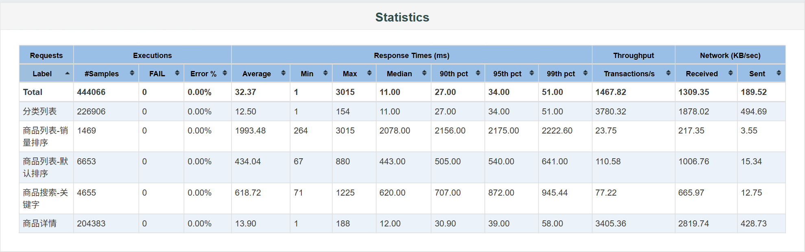
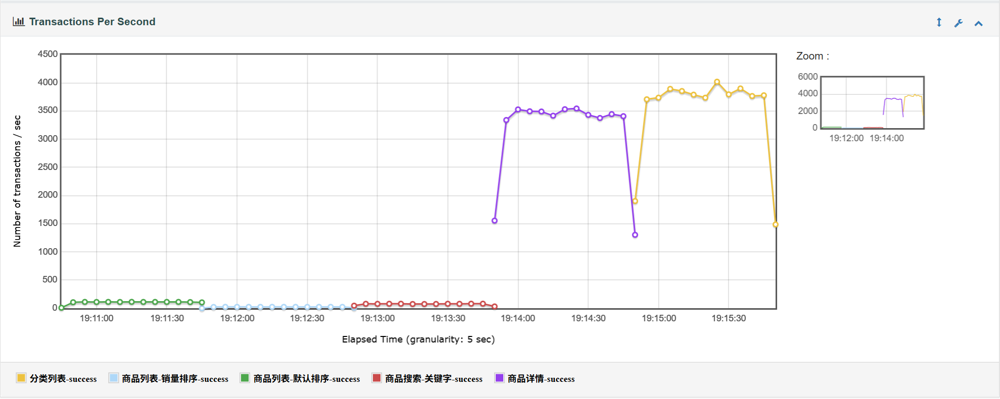
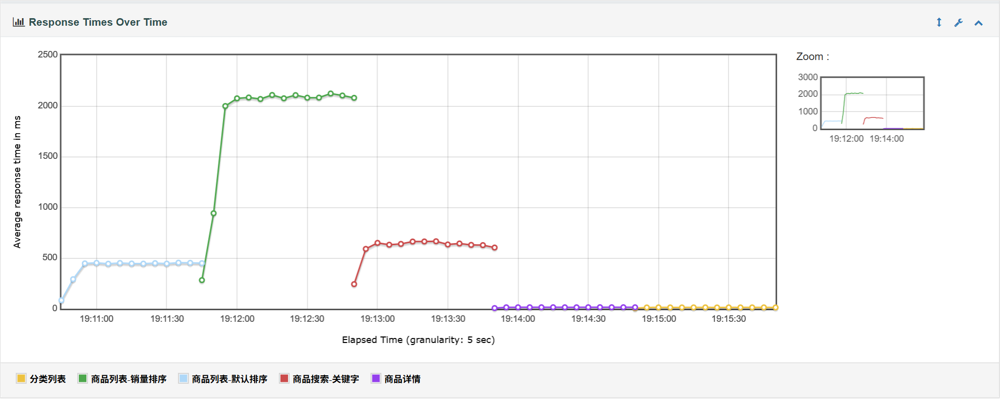
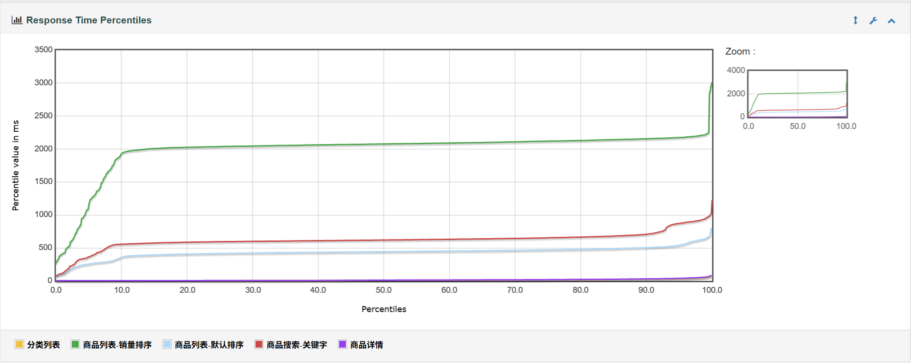
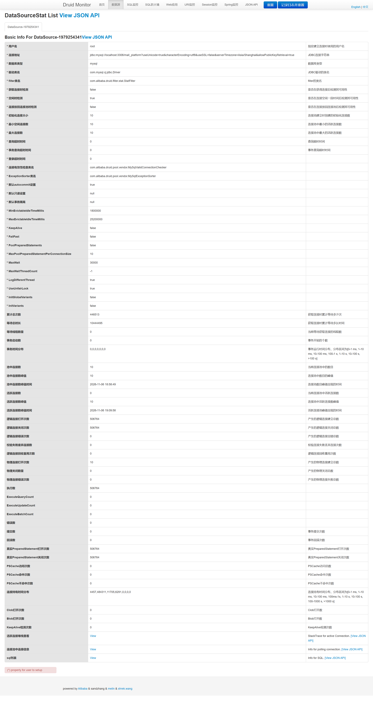
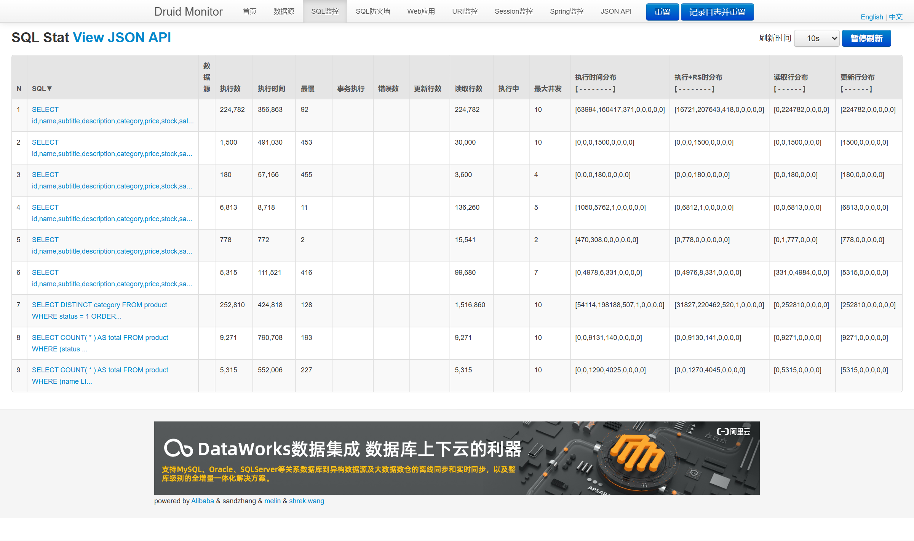

# Prompt Pals（电商平台）

个人全栈项目：**Java 后端 + Vue 3 前端**的电商平台，并接入 Python 智能体服务（电商智能客服、电商问数 Text2SQL），为其提供业务数据与工具接口。

## 项目结构

| 目录 | 说明 | 状态 |
|---|---|---|
| [`api/`](api/) | Java 后端：平台业务 API、面向 AI 智能体的工具接口 | 骨架已就绪 |
| [`web/`](web/) | Vue 3 前端：商城前台 + 管理端 | 骨架已就绪 |
| `agent/` | Python 智能体服务：智能客服 / 问数） | 规划中 |

## 技术栈

- **后端**：Java 21 · Spring Boot 4.1 · Maven（已引入 Web MVC / Validation 起步依赖）
- **前端**：Vue 3 · TypeScript · Vite · Pinia · Vue Router
- **数据与基础设施**：MyBatis-Plus · MySQL · Druid（连接池）· Redis（商品缓存）· RocketMQ（消息队列）· RustFS（S3 兼容对象存储）
- **智能体（规划中）**：Python · FastAPI · LangGraph · Milvus

界面支持中英文切换，商城与管理端顶部工具栏提供语言按钮，登录注册页跟随全局语言设置。切换会即时更新页面文案及 Element Plus 组件，保留当前表单输入，并在刷新后恢复所选语言。翻译字典位于 `web/src/i18n/`，商品名称、用户资料等业务内容保留原文。

## 快速开始

### 环境要求

- JDK 21+
- Node.js ≥ 22.18
- Maven 3.9+
- MySQL 8（本机安装）
- Docker Desktop（运行 Redis、RocketMQ、RustFS）

### 本地依赖（Redis + RocketMQ + RustFS）

```bash
docker compose up -d     # 仓库根目录执行：Redis 8.10 + RocketMQ 5.5 + RustFS 1.0
docker compose stop      # 停止
```

端口：Redis **6379**、RocketMQ NameServer **9876** / Broker **10911** / Proxy gRPC **8081**、RustFS S3 API **9000** / 控制台 **9001**（`/rustfs/console/`），均只绑定 127.0.0.1。更多命令见 [`docker-compose.yml`](docker-compose.yml) 顶部注释。

### 后端（api/）

已有数据库接入个人资料地点功能时，先执行 [`upgrade-user-location.sql`](api/src/main/resources/db/upgrade-user-location.sql)，为 `user` 表新增省份和城市列，再重启后端。新建库的 [`schema.sql`](api/src/main/resources/db/schema.sql) 已包含这两个字段。

收货地址在个人中心保存，下单页直接展示个人资料中的名字、手机号和收货地址，并提供修改入口。已有数据库先执行 [`upgrade-user-receiver-address.sql`](api/src/main/resources/db/upgrade-user-receiver-address.sql)，新增默认收货地址字段，再重启后端；新建库的 `schema.sql` 已包含该字段。

后端依赖 RocketMQ，启动前先执行 `docker compose up -d`；首次使用还要建一次 Topic 和消费组（命令见 [`docker-compose.yml`](docker-compose.yml) 顶部注释）。

```bash
cd api
./mvnw spring-boot:run        # Windows 下使用 mvnw.cmd spring-boot:run
```

下单后 15 分钟未支付的订单会自动取消并回补库存（RocketMQ 延时消息 + 定时扫描兜底），时长可用 `ORDER_PAY_TIMEOUT` 调整。

下单接口 `POST /order/create` 必须携带 `requestId`（16～64 位字母、数字、下划线或连字符）。前端为每次结算生成请求号，网络失败和刷新后的重试复用原请求号，成功后再次购买生成新号。同一用户、同一请求号和相同内容会返回已有订单；同号不同内容会被拒绝。后端按「查库幂等 → Redisson 分布式锁 → 锁内再次查库 → 独立事务下单 → 提交后解锁」处理，数据库唯一索引兜底，库存、订单、明细和购物车操作一起提交或回滚。

已有数据库先执行 [`upgrade-order-idempotency.sql`](api/src/main/resources/db/upgrade-order-idempotency.sql)，增加 `orders.request_id`、`request_hash` 和 `(user_id, request_id)` 唯一索引，再重启后端；脚本可重复执行，旧订单保持为空，新建库的 `schema.sql` 已包含这些字段。Redis 不可用时新下单返回可重试的业务错误，已完成请求仍能按请求号查库返回；等锁时间可用 `ORDER_CREATE_LOCK_WAIT` 调整，默认 3 秒，持锁期间由 Redisson watchdog 自动续期。

下单的真实 Redis / MySQL 并发验证可在 PowerShell 中设置 `$env:ORDER_IDEMPOTENCY_INTEGRATION_TESTS = 'true'` 后运行后端测试。测试使用随机请求号和临时商品，结束后清理自己创建的订单和商品；真实消息消费、超时扫描及支付对账均禁用。

前台商品列表、详情、分类缓存在 Redis（`127.0.0.1:6379`，可用 `REDIS_HOST` / `REDIS_PORT` 修改）；Redis 没启动时后端照常运行，只是每次都查库。

### 商品收藏与通知

商城顶栏的通知铃铛位于主题切换和购物车之间，显示未读数量，点击展开最近 8 条通知，下拉框底部可进入 `/notifications`。商品详情页的爱心收藏按钮与“加入购物车”“立即购买”位于同一行，用户菜单的“我的收藏”进入 `/favorites`，可在收藏列表中取消收藏；下架商品保留在收藏列表中，重新上架后提醒。收藏关系按账号持久化，游客点击详情页的爱心先登录。

管理员编辑商品价格或把商品从下架改为上架时，后端按实际变化生成 `LISTED`、`PRICE_DROP`、`PRICE_RISE` 事件。价格数值不变、重复上架、改名或库存增减不发通知；一次修改同时上架和变价会分别提醒。商品修改与事件在同一数据库事务中提交，发件箱默认每 2 秒经 RocketMQ 发送，失败重试；消费者将通知落库后通过 WebSocket 推送在线用户。事件处理标记和 `(event_id, user_id)` 唯一索引防止重复消费，通知保留商品名、图片及变价前后的价格快照。

只提醒事件发生之前已收藏且消费时仍在收藏的用户，取消后重新收藏不会补发旧事件。通知中心支持全部/未读筛选、单条已读、全部已读和查看商品；离线消息在登录或重连后查询恢复，断线自动重连，退出登录关闭连接并清空角标。单条和全部已读只操作 JWT 对应账号，也同步该账号的其他在线页面。

管理端顶栏也提供通知铃铛和 `/admin/notifications` 通知中心。买家提交普通、购物车或秒杀订单成功后，向当时启用的管理员和 super管理员分别保存一条新订单通知，展示订单号、买家姓名及用户名、订单金额；点击通知或实时提醒会标为已读并打开 `/admin/orders?orderId=...` 的订单详情抽屉。每位管理员的已读状态独立，普通买家无权访问 `/admin/notification` 接口。

新订单通知与订单、明细和库存处于同一数据库事务，提交后复用通知 WebSocket 推送，无需新增 RocketMQ Topic。回滚不留通知，同一 `requestId` 重试不重复提醒；离线、推送失败或提交后进程中断时，已保存的通知在登录、重连或刷新时恢复。只提醒新提交的订单，不补发历史订单。

已有数据库先执行 [`upgrade-order-notifications.sql`](api/src/main/resources/db/upgrade-order-notifications.sql)，新增 `order_notification` 表，再重启后端；脚本可重复执行，新建库的 `schema.sql` 已包含该表。

管理员发货成功后，订单买家会在商城通知铃铛、通知中心和实时弹窗收到“已发货”通知，展示订单号、金额和发货时间，点击可标为已读并打开自己的订单详情。发货通知与订单状态在同一事务中保存，提交后推送；离线时保留通知，登录、重连或刷新后恢复。只通知对应订单买家，重复发货或发货失败不重复提醒，回滚不留通知。

已有数据库先执行 [`upgrade-order-shipment-notifications.sql`](api/src/main/resources/db/upgrade-order-shipment-notifications.sql)，新增 `order_shipment_notification` 表，再重启后端；脚本可重复执行，不补发历史订单，新建库的 `schema.sql` 已包含该表。商城 `/notification` 将商品通知与发货通知按时间合并分页，并统一未读数量和全部已读；单条发货通知的 `/notification/read` 请求携带 `{id, type: "ORDER_SHIPPED"}`，避免与商品通知相同 ID 的记录混淆。复用现有 WebSocket，无需新增消息 Topic。

在 `api/` 的 PowerShell 中设置 `$env:ORDER_NOTIFICATION_INTEGRATION_TESTS = 'true'`，运行 `mvn.cmd -Dtest=OrderNotificationIntegrationTests test`，可验证真实 HTTP / MySQL / Redis / WebSocket 链路，包括两个管理员角色、同账号多个页面、离线记录、幂等重试、读状态隔离和失败回滚。测试使用随机端口与临时账号、商品，关闭真实消息及定时任务，并在结束后清理自身数据。

已有数据库先执行 [`upgrade-product-notifications.sql`](api/src/main/resources/db/upgrade-product-notifications.sql)，新增 `product_favorite`、`product_notification_event`、`product_notification` 三张表，再重启后端；脚本可重复执行，新建库的 `schema.sql` 已包含这些表。首次使用还需要创建普通消息 Topic 和消费组：

```bash
docker compose exec rmqbroker sh mqadmin updateTopic -n rmqnamesrv:9876 -c DefaultCluster -t product-notification -a +message.type=NORMAL
docker compose exec rmqbroker sh mqadmin updateSubGroup -n rmqnamesrv:9876 -c DefaultCluster -g product-notification-consumer
```

WebSocket 使用 `POST /notification/socket-ticket` 将 JWT 换成 30 秒内有效的一次性短票，再连接 `/ws/notifications?ticket=...`，连接 URL 不携带 JWT 或客户端指定的用户 ID，JWT 到期后关闭连接。允许的前端 Origin 默认是 `http://localhost:5173` 和 `http://127.0.0.1:5173`，部署或修改前端端口时通过 `NOTIFICATION_ALLOWED_ORIGINS` 配置（多个地址逗号分隔）。HTTPS 前端使用 WSS，反向代理须转发 WebSocket Upgrade。

当前实时连接在单个后端进程中管理，适用于本项目的单实例部署；多个实例共享消费组时通知记录仍会保存，但实时推送需要另加跨实例广播。数据库测试默认关闭真实商品通知消息及发件箱扫描，以免消费开发环境消息。

真实 RocketMQ / WebSocket 链路测试使用独立 Topic `product-notification-test` 和消费组 `product-notification-test-consumer`，须先按上面的命令替换名称创建。然后在 `api/` 的 PowerShell 中设置 `$env:PRODUCT_NOTIFICATION_INTEGRATION_TESTS = 'true'`，运行 `mvn.cmd -Dtest=ProductNotificationMqIntegrationTests test`。测试使用随机商品和账号标识，验证三类实时提醒、短票重放拒绝、离线通知与已读隔离，结束后清理自身数据；不扫描或消费开发环境队列。

### 库存调整与秒杀

后台“商品管理”的编辑表单只修改商品信息；补货、减少库存通过列表里的“库存”操作完成。`POST /admin/product/stock` 接收 `{id, delta}`，按提交时的当前库存原子增减，拒绝零增量、负库存和整数溢出。旧客户端即使在商品编辑请求里发送 `stock`，也不会覆盖下单已扣减的库存。

商城 `/seckill` 提供秒杀活动筛选、倒计时、秒杀价、剩余配额和每人限购提示；首页和顶栏均有入口。管理员在 `/admin/seckill` 选择上架商品，配置活动价、配额、限购数量和起止时间。创建时把配额从普通库存划拨到独立的秒杀库存，活动价必须低于当前售价；关闭或到期后自动归还未售配额，默认每 30 秒扫描。

秒杀结算复用收货地址、订单和支付流程：`POST /order/create` 额外携带 `seckillActivityId`，只允许单独结算一个活动商品。价格由服务端确定，活动 ID 参与请求内容哈希；同号同内容的失败重试、刷新和响应丢失仍返回已有订单。取消和退款释放限购额度；活动开放时归还秒杀配额，关闭或结束后归还普通库存。

Redis Lua 把库存检查、每人额度检查、请求预占和扣减合并执行，数据库用活动库存条件更新、用户额度条件更新和订单唯一索引作最终校验。Redis 预扣缓存固定 10 秒过期，数据库失败显式补偿，进程崩溃或缓存重建不会绕过数据库防超卖与限购；Redis 预扣与数据库不构成跨系统事务。Redis 不可用时新秒杀订单返回可重试的错误。

已有数据库先执行 [`upgrade-seckill.sql`](api/src/main/resources/db/upgrade-seckill.sql)，增加 `seckill_activity`、`seckill_purchase`、订单明细活动字段和索引，脚本可重复执行；新建库直接使用 `schema.sql`。在 `api/` 的 PowerShell 中设置 `$env:SECKILL_INTEGRATION_TESTS = 'true'` 后运行 `.\mvnw.cmd test`，可执行真实 Redis / MySQL 并发验证，覆盖抢完库存、不同请求号限购、数据库兜底、失败补偿、取消、退款和到期回补。测试禁用真实消息和定时任务，只清理自己创建的随机数据。

头像、商品图片上传到 RustFS（AWS SDK for Java 2.x，S3 path-style 访问），默认使用 `mall-uploads` 私有桶，首次上传会自动创建。上传接口保持 `POST /upload/avatars`（需登录）和 `POST /upload/images`（仅管理员），支持 JPG / PNG / GIF / WEBP，单个文件不超过 5MB；扩展名和 Content-Type 按文件内容识别。返回的 `/avatars/...`、`/images/...` 由后端从 RustFS 读取，前端和数据库仍保存这些稳定路径。连接信息可在 `api/.env` 里通过 `RUSTFS_*` 修改（见 [`api/.env.example`](api/.env.example)）；RustFS 暂未启动时后端仍可启动，上传或读取文件返回 503。

已有本地上传文件时，先迁移到 RustFS 再重启后端。以下命令在 `api/` 下的 PowerShell 中执行，最后的目录替换成原来的 `UPLOAD_ROOT`（原默认目录为 `$env:USERPROFILE/mall-platform/uploads`）：

```powershell
.\mvnw.cmd -DskipTests compile dependency:build-classpath "-Dmdep.outputFile=target/rustfs-classpath.txt"
$rustfsClasspath = (Get-Content -Raw target/rustfs-classpath.txt).Trim() + ';target/classes'
java --class-path $rustfsClasspath tools/MigrateUploads.java D:/mall-platform/uploads
```

迁移工具读取 `api/.env` 中的 `RUSTFS_*`，保留 `avatars/`、`images/` 下的文件名，并用 SHA-256 核对迁移内容；不改数据库、不删除原文件，重复执行会跳过已存在的对象。迁移后 `UPLOAD_ROOT` 不再参与后端存储。

后端测试用 `.\mvnw.cmd test`。需要验证真实 RustFS 时，在 PowerShell 中先设置 `$env:RUSTFS_INTEGRATION_TESTS = 'true'` 再运行测试；集成测试使用独立的随机桶并自动清理，覆盖上传、读取、私有访问和迁移条件写入。

服务默认端口 **8080**。
数据库连接池监控（Druid）：<http://127.0.0.1:8080/druid/>，只允许本机访问，默认账号 druid / druid123（可在 `api/.env` 里改）。
打包命令：`./mvnw clean package`。

### 支付宝沙箱支付

已接入支付宝官方 SDK：下单后跳转收银台，付款返回后主动查询确认支付；异步通知通过 RSA2 验签，并校验应用、金额和交易号。查询与回调共用事务，重复通知不会重复累计销量。管理端支付流水可查看和搜索第三方交易号。

已有数据库先执行 [`upgrade-alipay-payment.sql`](api/src/main/resources/db/upgrade-alipay-payment.sql)，增加 `payment.trade_no` 及索引；脚本可重复执行，不改动已有流水。新建库的 `schema.sql` 已包含这些字段。

在被 Git 忽略的 `api/.env` 中填写 `ALIPAY_APP_ID`、`ALIPAY_APP_PRIVATE_KEY`、`ALIPAY_PUBLIC_KEY`，设置 `ALIPAY_ENABLED=true` 后重启后端。配置模板见 [`api/.env.example`](api/.env.example)，网关默认使用支付宝沙箱；可选的 `ALIPAY_SELLER_ID` 用于额外校验回调收款方。

支付宝 SDK 的原始请求日志已关闭，避免记录包含签名的请求 URL；业务日志记录操作与错误码。

| 接口 | 用途 |
|---|---|
| `GET /payment/methods` | 查询当前启用的支付方式 |
| `POST /payment/pay`，JSON `{orderId, method: "ALIPAY"}` | 创建或复用待支付流水，返回 `payment` 和 `payUrl` |
| `GET /payment/query?orderId=...` | 查询支付宝，同步订单与流水，返回 `order`、`payment`、`paid` |
| `POST /payment/alipay/notify` | 支付宝异步通知，免 JWT，验签后返回纯文本 `success` / `failure` |
| `POST /order/refund` / `POST /admin/order/refund` | 支付宝确认原路退款后，更新订单、流水和库存 |

操作：提交订单 → 选择支付宝 → 使用**沙箱买家账号**付款 → 返回商城查看订单；未确认时可点“查询支付结果”。默认返回地址为 `http://localhost:5173/payment/return`，通过 `ALIPAY_RETURN_URL` 修改为实际前端地址，浏览器地址和配置应使用同一域名。

`localhost` 无法接收支付宝服务器的异步通知。本机开发通过返回页主动查询和每分钟定时对账同步结果；对账按流水 ID 分页轮询，每轮最多 100 条，查询失败的流水在下一次循环重试，后续流水仍会继续处理。同一订单的旧流水也按其支付流水号查询，重复收款会自动退款。需要验证异步通知时，把 `ALIPAY_NOTIFY_URL` 配置为公网可达的 `/payment/alipay/notify` 地址。取消和超时处理先查询、关闭未付款交易；取消后才打开旧支付链接并完成的付款会自动原路退款。退款失败不会修改本地订单和库存，重试使用同一退款请求号。

支付宝默认关闭，模拟支付默认保留。正式收款时配置正式应用、密钥和 `ALIPAY_GATEWAY_URL=https://openapi.alipay.com/gateway.do`，并设置 `PAYMENT_MOCK_ENABLED=false`。定时对账可通过 `PAYMENT_RECONCILE_ENABLED=false` 关闭；后端应用上下文和支付数据库测试会禁用真实消息消费、定时对账，并回滚测试数据。

### 前端（web/）

```bash
cd web
npm install
npm run dev        # 开发服务器，默认端口 5173
```

打包命令：`npm run build`（类型检查 + 生产构建）

## 性能压测

商品接口用 JMeter 压测，脚本和一键运行脚本在 [`api/bench/`](api/bench/)（`run.cmd <结果名> [并发数] [秒数]`，先 10 并发预热 10 秒再正式压测）。

- 数据量：商品表 **10 万条**（`api/src/main/resources/db/bench-product.sql` 生成）
- 压测方式：5 个场景**依次**执行（线程组串行），每个场景 **50 并发、持续 60 秒**，ramp-up 5 秒
- 环境：本机单机（后端、MySQL、Redis、JMeter 同一台 Windows 笔记本，插电），结果仅作优化前后对比参考
- 三轮在同一天夜里依次跑完，后端都用 `java -jar` 启动打包好的 jar（`spring-boot:run` 会带上 devtools 和 `-XX:TieredStopAtLevel=1`，JIT 只做初级编译，压测数据偏低）

### 优化前后对比

| 场景 | 接口 | 基线 | 加销量索引 | 加 Redis 缓存 |
|---|---|---:|---:|---:|
| 分类列表 | `GET /product/categories` | 3502 req/s · 13.5 ms | 4107 req/s · 11.5 ms | **6567 req/s · 7.2 ms** |
| 商品详情 | `GET /product/{id}`（随机 id） | 3822 req/s · 12.4 ms | 3718 req/s · 12.7 ms | **3930 req/s · 12.0 ms** |
| 商品列表-默认排序 | `GET /product?page=1~10&pageSize=20` | 98 req/s · 488 ms | 97 req/s · 494 ms | **1529 req/s · 31 ms** |
| 商品搜索-关键字 | `GET /product?keyword=...` | 63 req/s · 754 ms | 69 req/s · 691 ms | **2000 req/s · 23 ms** |
| 商品列表-销量排序 | `GET /product?sort=sales` | 20 req/s · 2394 ms | 85 req/s · 563 ms | **1462 req/s · 33 ms** |

每格为「吞吐量 · 平均响应时间」，三轮错误率均为 0%。P99：销量排序 3860 → 1631 → 62 ms，关键字搜索 1288 → 1191 → 67 ms，商品详情 53 → 57 → 27 ms。

**加销量索引** `idx_sales (sales)`：销量排序原来全表扫描 + filesort，加索引后倒序读索引、读够一页就停，单条 SQL 从约 270 ms 降到 20 ms，接口吞吐量 ×4.3。剩下的时间花在每次请求都要做的 `COUNT(*)`（统计在售总数，约 50~100 ms）上，和默认排序持平；其余接口不受影响。

- 没用 `(status, sales)`：先试过这个组合索引，销量排序一样快，但 `status` 只有 0/1 且九成是 1，优化器会拿它走 ref——关键字搜索的 COUNT 先读 9 万条索引项再逐条回表，接口吞吐量从 77 掉到 13 req/s；按价格 / 最新排序也慢了一倍多（单条 SQL 实测）。

**加 Redis 缓存**（Spring Cache + Redis，Cache Aside，配置见 `CacheConfiguration`）：前台列表、计数、详情、分类都先查 Redis。列表类接口吞吐量提高 15~30 倍，响应时间从数百毫秒降到 30 ms 左右。

- 详情接口吞吐量基本没变：按主键查一行本来就不到 2 ms，瓶颈在 HTTP 和 JSON 序列化；而且压测在 10 万个 ID 里随机取，平均每个 ID 只被访问两三次，首次访问都要查库（未命中约四成）。缓存主要压低了长尾（P99 减半）、减轻了数据库压力
- 这是缓存的最佳情况：压测只读，列表只有 10 页、搜索词只有 16 个，几乎全部命中；真实流量里搜索词分散、还有写操作，提升幅度会小一些
- 一致性：后台改商品后立即删详情、清空列表缓存；下单、支付、取消改了库存 / 销量只删详情，列表里的库存、销量最多旧 1 分钟（列表缓存的过期时间）。删缓存都在事务提交之后
- 防护：不存在的商品缓存空值 1 分钟（缓存穿透）；过期时间随机加 0~10%（缓存雪崩）；Redis 挂了只记日志、直接查库，接口照常返回

<details>
<summary>首次基线压测截图（2026-11-06，JMeter 报告 / Druid 监控）</summary>

首次基线用 `spring-boot:run` 启动，数据和上表的「基线」列接近（销量排序 23.8 req/s · 1994 ms，默认排序 110.6 req/s · 434 ms）。









</details>

## Roadmap

- 前后端工程骨架（Spring Boot 4.1 + Vue 3 + Vite）
- 数据库设计：业务 6 表（用户 / 商品 / 订单主表+明细 / 购物车 / 支付流水）+ AI 域（会话 / 知识库 / 反馈）
- 主站核心业务：登录鉴权、商品浏览、下单与库存
- 基础设施接入：MySQL / Redis / RocketMQ / RustFS（docker-compose 一键启动）
- 面向智能体的工具接口：订单 / 库存 / 售后查询（供客服 Agent 调用）
- 面向问数的接口：元数据服务 + 受权限控制的查询执行
- 接入 Python 智能体服务：SSE 流式对话与问数
